# Informe Entrega Final — Variante C - catalogo-app

Este informe documenta la entrega final de catalogo-app (Variante C) en el clúster. Cada sección está acompañada de evidencias: comando ejecutado y capturas del resultado:

1. La aplicación responde por Ingress y se puede cargar un producto y su imagen.
2. El HPA sube las réplicas de la API bajo carga y las baja al cesar.
3. Helm registra un upgrade de la API a `v2` y el rollback a la versión anterior.
4. Prueba de que cambiar un valor en `values.yaml` cambia el YAML que genera el chart, utilizando `helm template` dos veces sobre la plantilla.
5. Un archivo escrito en el disco de un Pod de la API no existe en la otra réplica.

Las capturas enlazadas se encuentran en la carpeta `informe/`.

---

## 1) Aplicación vía Ingress, con producto e imagen cargados en el navegador

### Demostración

1. Se muestra que el Ingress existe y que la columna ADDRESS tiene asignada una dirección IP:

```bash
kubectl get ingress -n catalogo-app
```
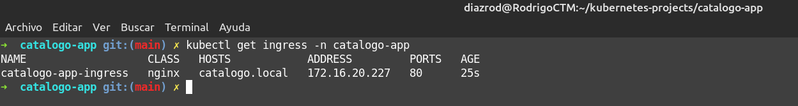

2. Se muestra que se agregó una entrada al archivo hosts de la máquina de prueba local para asociar la dirección IP obtenida con un nombre de dominio local.

```bash
# Agregado de entrada al archivo hosts
echo "172.16.20.227 catalogo.local" | sudo tee -a /etc/hosts
```
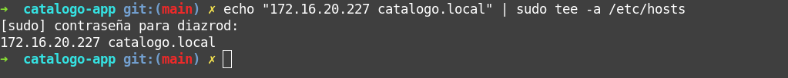

```bash
#Comprobación de resolución de IP por dominio
getent hosts catalogo.local
```
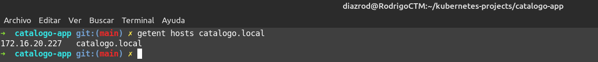


3. Demostración de carga de imagen: se abre en navegador `http://catalogo.local`. Desde la UI se crea un producto con nombre y SKU distinto de cualquier producto del catálogo demo (SKU usado: 12345678) y se adjunta una imagen.


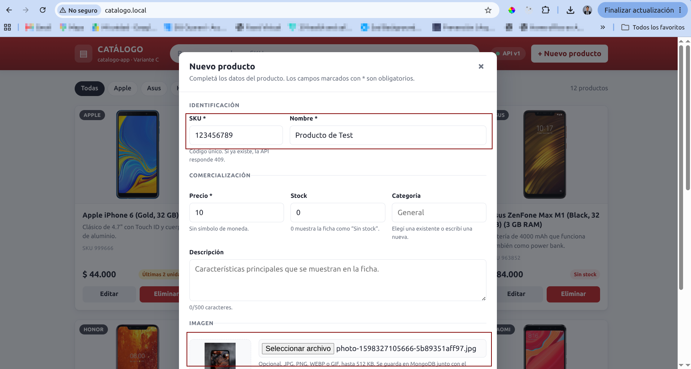
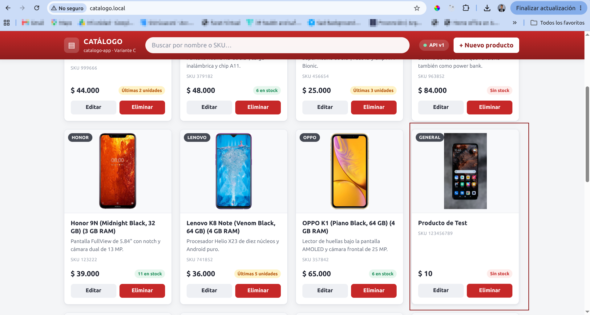

4. Adicionalmente se verifica que la API devuelve ese producto a través del proxy del frontend.

```bash
curl -s http://catalogo.local/api/productos | grep "123456789"
```
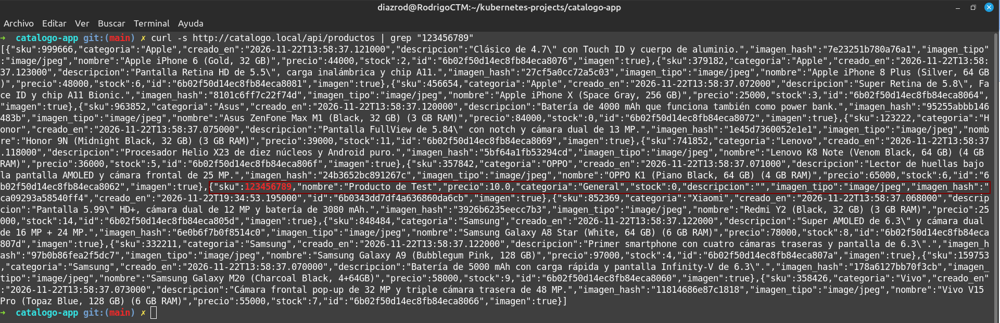

---

## 2) HPA: réplicas suben bajo carga y bajan cuando la carga cesa

### Demostración

1. En Terminal A se observa el HPA en tiempo real:

```bash
kubectl get hpa -n catalogo-app -w
```
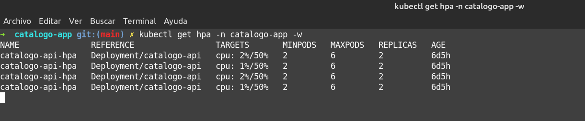

2. En la terminal B se genera carga desde el clúster, mediante un Pod temporal que solicita de manera reiterada el listado de productos.

```bash
kubectl run carga --rm -it --restart=Never -n catalogo-app --image=busybox:1.36 -- \
  /bin/sh -c 'while true; do wget -q -O- http://catalogo-api:8000/productos; done'
```
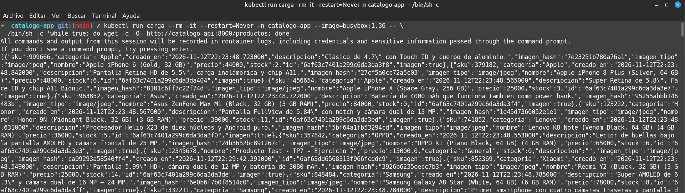

3. Se observa que bajo carga el número de réplicas aumenta de 2 a 6.

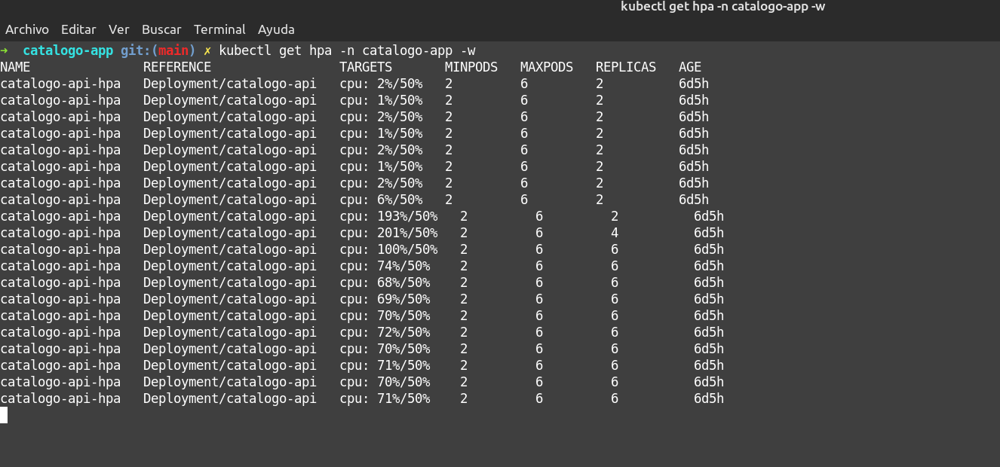

4. Se detiene el proceso que genera carga con el objetivo de mostrar el descenso del número de réplicas. Se utiliza la combinación de teclas Ctrl + C para detener el proceso en la terminal B.

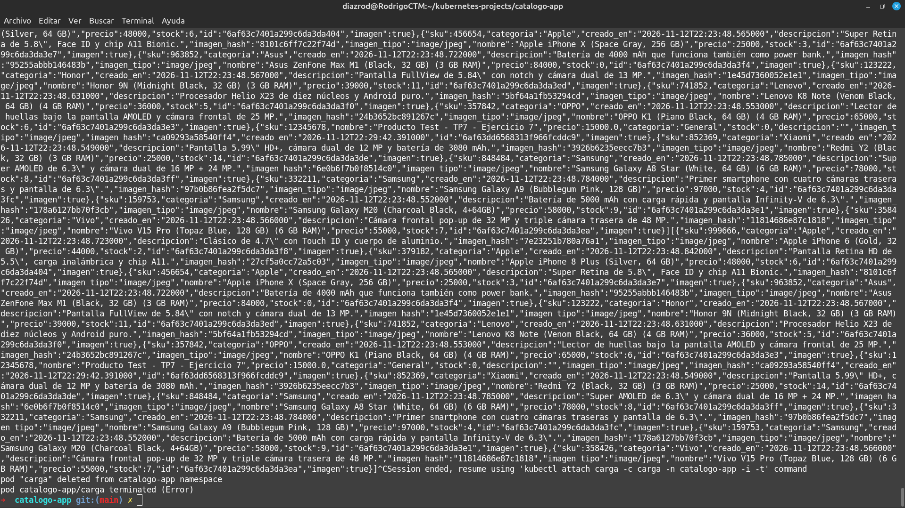

5. Luego de unos minutos se observa que, con el descenso de carga, el número de réplicas vuelve al valor mínimo definido en el HPA: 2 réplicas.

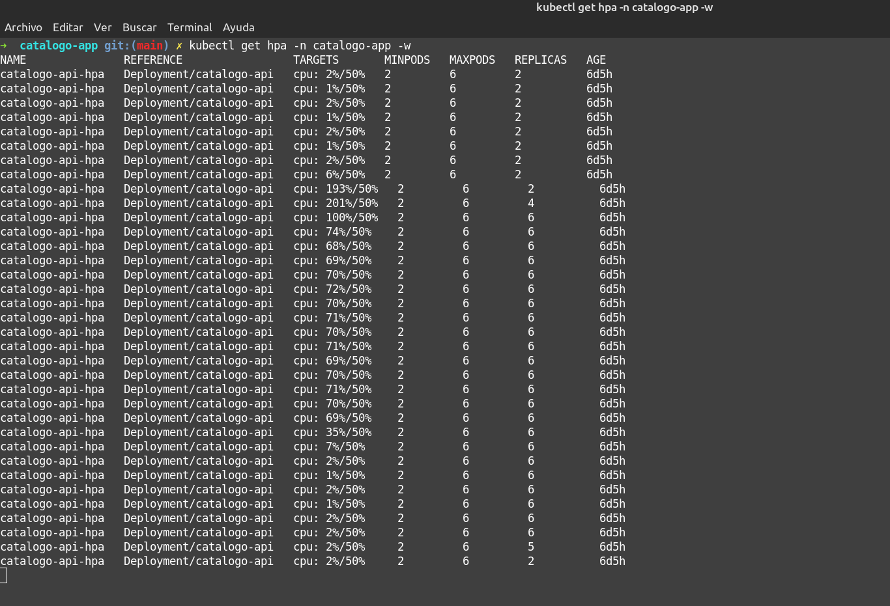


---

## 3) `helm history` tras upgrade y rollback

### Demostración

1. Se muestra el estado inicial: se consulta la versión de la API a través de `GET /api/health` (también se visualiza el badge **API v1** en `http://catalogo.local`). Además se muestra la lista de releases de Helm que existen en el namespace.


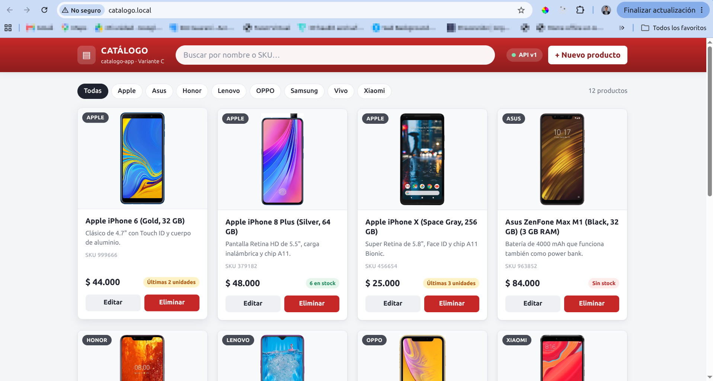

```bash
helm list -n catalogo-app
```
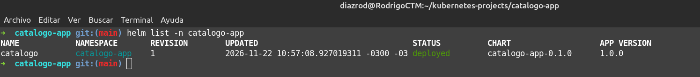

2. Se actualiza la release cambiando únicamente el tag de la imagen de la API a `v2`. El tag del frontend no se modifica.

```bash
helm upgrade catalogo ./catalogo-app --namespace catalogo-app --set api.image.tag=v2
```
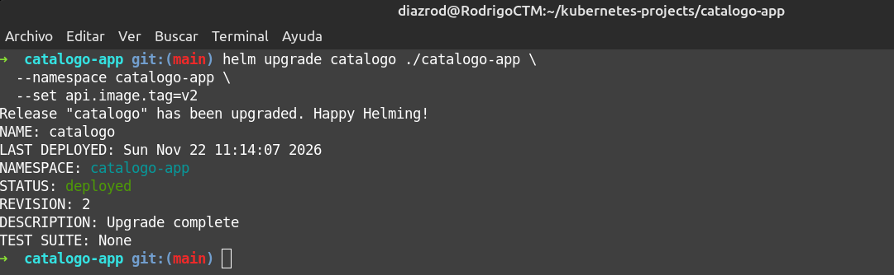

3. Se espera a que el Deployment de la API termine el rollout.

```bash
kubectl rollout status deployment/catalogo-api -n catalogo-app
```


4. Después del upgrade se consulta el historial: la revisión 2 queda `deployed` y la 1, `superseded`. La columna APP VERSION permanece en `1.0.0`: sale de `appVersion` en `Chart.yaml`, no del badge de la API.

```bash
helm history catalogo -n catalogo-app
```
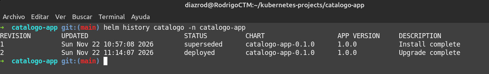

5. En el navegador se observa el cambio de versión **API v2**.

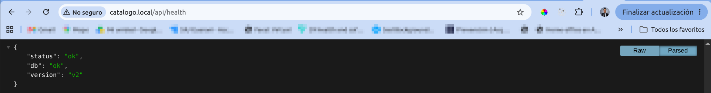


6. Se revierte la release a la revisión anterior y se espera el rollout de la API.

```bash
helm rollback catalogo -1 n catalogo-app
```
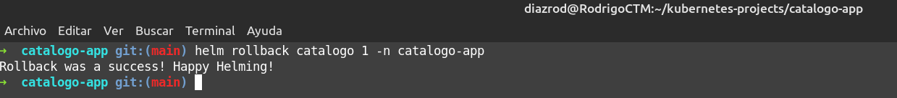

```bash
kubectl rollout status deployment/catalogo-api -n catalogo-app
```
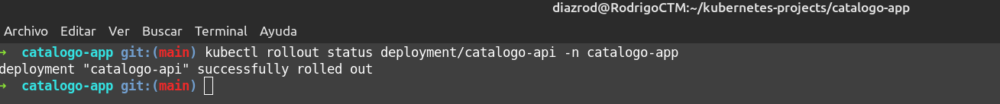

7. Se vuelve a consultar el historial. Aparece la revisión 3 como `deployed` (rollback a la revisión 1) y la revisión 2 queda `superseded`.

```bash
helm history catalogo -n catalogo-app
```
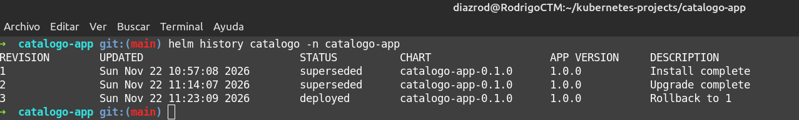

8. En el navegador el badge vuelve a **API v1**.

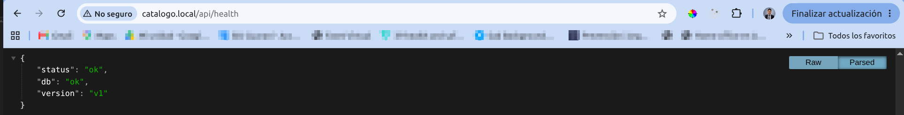
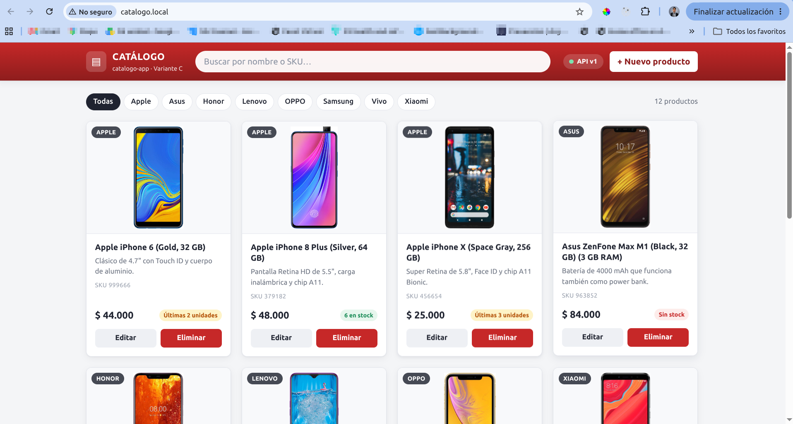

---

## 4) Parámetro de `values.yaml` real (no decorativo)

### Demostración

1. Se renderiza la plantilla del HPA usando el valor por defecto definido en `catalogo-app/values.yaml`. Con `grep` se deja en la terminal solo la línea de `maxReplicas`, para comprobar que ese valor coincide con la definición en `values.yaml`.

```bash
helm template catalogo ./catalogo-app -n catalogo-app \
  --show-only templates/hpa-catalogo-api.yaml | grep maxReplicas
```
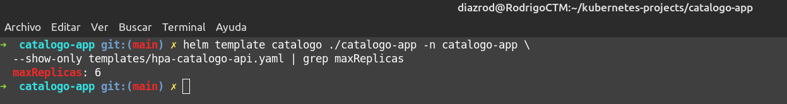

2. Se vuelve a renderizar la misma plantilla, pero modificando el número de réplicas: `hpa.maxReplicas=8`. La línea pasa a `maxReplicas: 8`.

```bash
helm template catalogo ./catalogo-app -n catalogo-app \
  --show-only templates/hpa-catalogo-api.yaml \
  --set hpa.maxReplicas=8 | grep maxReplicas
```
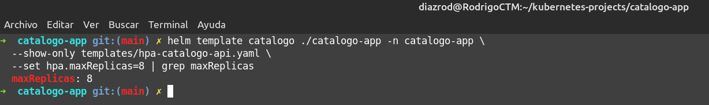

Se observa que la misma plantilla produce manifiestos distintos. La clave `hpa.maxReplicas` no es decorativa: el template la lee de `values.yaml` y la escribe en el objeto HorizontalPodAutoscaler.

---

## 5) Disco local del Pod no compartido entre réplicas

### Demostración

1. Se listan los Pods de la API (se definieron 2 réplicas).

```bash
kubectl get pods -n catalogo-app -l app=catalogo-api
```
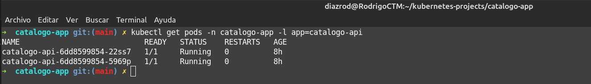

2. En un Pod (catalogo-api-6dd8599854-22ss7) se crea el archivo `/tmp/prueba-replica.txt` con contenido "prueba local". El archivo está en el disco de ese contenedor.

```bash
kubectl exec -n catalogo-app catalogo-api-6dd8599854-22ss7 -c catalogo-api -- \
  sh -c 'echo prueba-local > /tmp/prueba-replica.txt && cat /tmp/prueba-replica.txt'
```
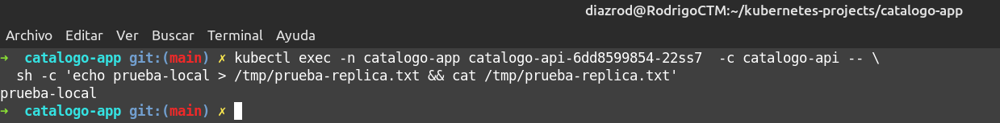

3. En la otra réplica (catalogo-api-6dd8599854-5969p) se intenta leer el mismo archivo. No existe: el disco de un Pod no puede ser accedido por otra réplica.

```bash
kubectl exec -n catalogo-app catalogo-api-6dd8599854-5969p -c catalogo-api -- \
  cat /tmp/prueba-replica.txt
```
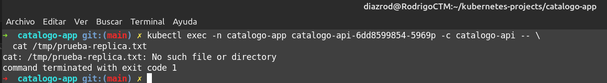

---
